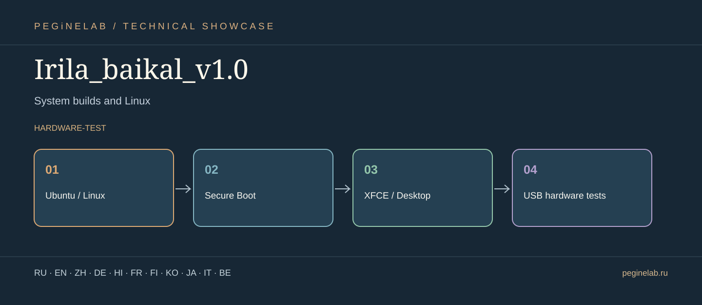

# Irila_baikal_v1.0 · Vector showcase & translations

**Системные сборки и Linux / System builds and Linux** · **Status:** hardware-test.

**Verified scope:** initial real hardware boot is documented; this does not guarantee all drivers or applications are ready.

**Document languages:** Eleven translations of the project overview. This is **not** a claim that every button, voice, or technical instruction is translated.

### Русский · ru
Экспериментальная Linux-система «Ирина Байкал 1.0».. **Irila_baikal_v1.0**: Ubuntu / Linux → Secure Boot → XFCE / Desktop → USB hardware tests.

### English · en
Irina Baikal 1.0: an experimental Linux-based operating system.. **Irila_baikal_v1.0**: Ubuntu / Linux → Secure Boot → XFCE / Desktop → USB hardware tests.

### 简体中文 · zh
Irina Baikal 1.0：实验性 Linux 操作系统。. **Irila_baikal_v1.0**: Ubuntu / Linux → Secure Boot → XFCE / Desktop → USB hardware tests.

### Deutsch · de
Irina Baikal 1.0: experimentelles Linux-basiertes Betriebssystem.. **Irila_baikal_v1.0**: Ubuntu / Linux → Secure Boot → XFCE / Desktop → USB hardware tests.

### हिन्दी · hi
Irina Baikal 1.0: प्रयोगात्मक Linux-आधारित ऑपरेटिंग सिस्टम।. **Irila_baikal_v1.0**: Ubuntu / Linux → Secure Boot → XFCE / Desktop → USB hardware tests.

### Français · fr
Irina Baikal 1.0 : système d'exploitation expérimental basé sur Linux.. **Irila_baikal_v1.0**: Ubuntu / Linux → Secure Boot → XFCE / Desktop → USB hardware tests.

### Suomi · fi
Irina Baikal 1.0: kokeellinen Linux-pohjainen käyttöjärjestelmä.. **Irila_baikal_v1.0**: Ubuntu / Linux → Secure Boot → XFCE / Desktop → USB hardware tests.

### 한국어 · ko
Irina Baikal 1.0: 실험적인 Linux 기반 운영체제.. **Irila_baikal_v1.0**: Ubuntu / Linux → Secure Boot → XFCE / Desktop → USB hardware tests.

### 日本語 · ja
システム構築と Linux. **Irila_baikal_v1.0**: Ubuntu / Linux → Secure Boot → XFCE / Desktop → USB hardware tests.

### Italiano · it
Build di sistema e Linux. **Irila_baikal_v1.0**: Ubuntu / Linux → Secure Boot → XFCE / Desktop → USB hardware tests.

### Беларуская · be
Сістэмныя зборкі і Linux. **Irila_baikal_v1.0**: Ubuntu / Linux → Secure Boot → XFCE / Desktop → USB hardware tests.

## Контакты · Contacts

- [Telegram @Feudorlab1](https://t.me/Feudorlab1)
- [Phone +7 926 041 1145](tel:+79260411145)
- [feudor.lab@yandex.ru](mailto:feudor.lab@yandex.ru) · [obzorniky@gmail.com](mailto:obzorniky@gmail.com)
- [peginelab.ru](https://peginelab.ru/) · [GitHub project](https://github.com/musikfed/Irila_baikal_v1.0)

The root README contains authoritative development and test status.
